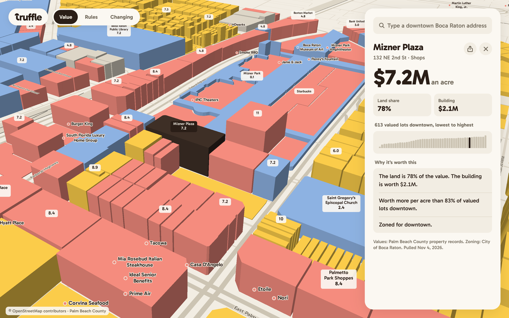

<p align="center">
  <a href="https://www.truffle.city">
    <picture>
      <source media="(prefers-color-scheme: dark)" srcset="public/brand/logo/truffle-logo-reversed.svg">
      
    </picture>
  </a>
</p>

<p align="center"><strong>Every lot in the city as a tile. Height is land value per acre, color is what it’s used for, and tapping it says why it’s worth what it is.</strong></p>

<p align="center">
  <a href="https://www.truffle.city"><strong>truffle.city</strong></a>
</p>

<p align="center">
  <a href="https://github.com/skirberg/truffle/actions/workflows/ci.yml"></a>
  <a href="LICENSE"></a>
</p>

[](https://www.truffle.city)

## What it is

Truffle is a map of a real city that looks and feels like a game. Every lot is a tile: its height is its land value per acre, its color is what it’s used for, and tapping it says what it is and why it’s worth what it is. Roads, water, town names and named places (Mizner Park, a Publix, a school) come from OpenStreetMap. It starts with Downtown Boca Raton and West Boca, in Palm Beach County, Florida.

- **The front door** opens on the lit city with one lot under fog, the same lot for everyone that day. Call it, more or less per acre than its neighbors, and it rises to its height while the panel says why. Send it to a friend, or move on to the next lot.
- **Value** stands every lot at its land value per acre, in the color of its use.
- **Rules** colors each lot by what its zoning allows.
- **Changing** raises the West Boca lots added to the county map since 2023.
- **A lot page** (`/lot/<parcel number>`) has the address, the value and the reasons in its HTML, so it reads without the map.

[](https://www.truffle.city/lot/06434720280000070)

## How it’s built

This repository is the site. A private pipeline pulls the public records, computes every lot’s numbers and writes the tiles and the records the site reads; it is not in this repository. What is here runs on a small sample of that output (see [Data](#data-and-credits)).

| Layer | What | Where |
|---|---|---|
| Site | Next.js 16 App Router, server rendered with Cache Components, React 19, TypeScript strict, security headers from `next.config.ts` | `app/`, `components/`, `lib/` |
| Look | Tailwind CSS 4 reading the design tokens through `@theme`; Base UI Tabs, Combobox and Drawer with no kit on top | `brand/tokens.json`, `app/globals.css` |
| Map | MapLibre GL JS `fill-extrusion` over PMTiles, read with HTTP range requests; labels from self-hosted glyphs | `components/board.tsx`, `public/glyphs/` |
| Data | The committed sample by default; Postgres with PostGIS when `DATABASE_URL` is set | `data/`, `lib/store.ts` |
| Brand | Icons, share art and the brand kit drawn on every build from the mark’s construction and the tokens | `scripts/brand.mjs`, `public/brand/` |
| Checks | Vitest, ESLint, a 4 px grid and token check, WCAG contrast, Playwright with axe | `tests/`, `e2e/`, `scripts/` |

`brand/tokens.json` is the one source for colors, type, the grid, motion and the map’s cameras; `DESIGN.md` is the design written out.

## Run it locally

You need Node 24 (`.nvmrc`). No keys, accounts or database.

```bash
git clone https://github.com/skirberg/truffle.git
cd truffle
npm install
npm run dev
```

Open http://localhost:3000. The site reads `data/snapshot.json.gz`, `data/tiles/lots.pmtiles` and `data/tiles/basemap.pmtiles`. `npm run dev` and `npm run build` first draw the tokens' CSS and the brand files (about 5 seconds).

## Configuration

Every variable is optional; with none set the site runs on the sample. `.env.example` lists them with what each does.

| Variable | What it changes |
|---|---|
| `DATABASE_URL` | Reads lots from a Postgres database (PostGIS, pg_trgm) loaded by the pipeline, instead of the sample |
| `NEXT_PUBLIC_SITE_URL` | The public address used in canonical links, the sitemap and share cards |
| `NEXT_PUBLIC_TILES_URL` | Where the map reads `lots.pmtiles` from, instead of `/tiles/lots.pmtiles` |
| `NEXT_PUBLIC_BASEMAP_URL` | Where the map reads `basemap.pmtiles` from, instead of `/tiles/basemap.pmtiles` |
| `REVALIDATE_SECRET` | The bearer secret `POST /api/revalidate` needs to expire cached pages after a pull |

## Checks

```bash
npm run typecheck
npm run lint
npm test
npm run build
```

`npm run check` runs all of them plus the 4 px grid check, contrast (WCAG for every color pair), `qa` (every route at 320, 375, 768, 1024 and 1440 px: axe, sideways scroll, tap targets) and `smoke` (the map really draws, a lot’s panel, search, the call, the phone sheet, share cards). The page checks need Playwright’s Chromium once (`npx playwright install chromium`) and run against `next start` on port 3427, with WebGL in software so a blank map can’t pass. Every pull request runs the same steps (`.github/workflows/ci.yml`).

## What’s not in this repository

- **The data pipeline**: pulling parcels, zoning and OpenStreetMap, computing each lot’s numbers, building the tiles and loading the database.
- **The full data.** Only a sample is here, and it holds no homes (below).
- **Deployment and hosting**: the Vercel project, the database and the tile storage, and their keys.
- **The generator of the share cards’ art.** Its output is committed in `brand/share/`.
- **Internal notes and decision records.**

## Data and credits

The sample in `data/` covers Downtown Boca Raton and West Boca and keeps only lots that are not homes: 497 businesses, civic and public land and other non-residential land. Houses, condominiums, townhouses, manufactured homes and empty residential land are left out of the records and the tiles, so this repository holds no list of home addresses or home values. The live site shows every lot; here the map is sparser, and calls compare a lot only with the non-residential lots around it.

- Map data © [OpenStreetMap contributors](https://www.openstreetmap.org/copyright), available under the [Open Database License 1.0](https://opendatacommons.org/licenses/odbl/1-0/). The credit is always on the map.
- Lots, land and building values, use and year added: Palm Beach County property records.
- Zoning inside Boca Raton: City of Boca Raton.
- Zoning on unincorporated land: Palm Beach County.
- Lots outside Palm Beach County, where the live site shows them: Florida Department of Revenue statewide cadastral data (none of it is in the sample).
- Values are the county’s assessed values as published, not appraisals.
- Gabarito, the typeface, is under the SIL Open Font License 1.1 (`assets/fonts/Gabarito-OFL.txt`).

`data/LICENSE` has the terms for the data.

## Licence

The code is under the [Functional Source License, Version 1.1, MIT Future License](LICENSE) (FSL-1.1-MIT): use, change and share it for anything except a competing product, and each release becomes MIT two years after it is published. The Truffle name, logo and wordmark are not licensed ([NOTICE](NOTICE)). The data keeps its sources’ terms ([data/LICENSE](data/LICENSE)).

Security problems: see [SECURITY.md](SECURITY.md).

By [skirberg](https://github.com/skirberg).
